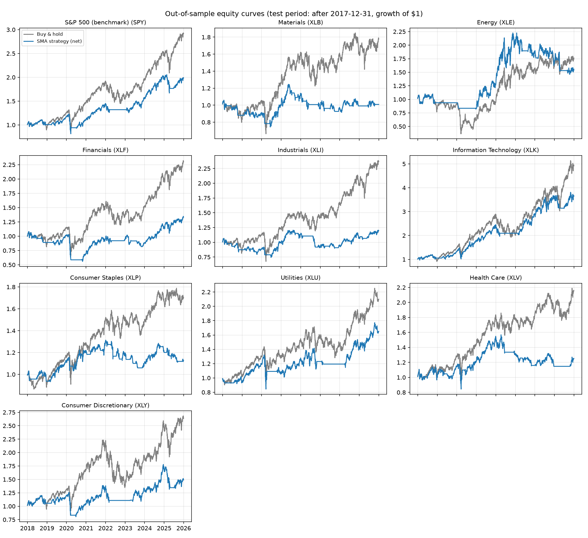

# Sector-Level Trend-Following Study

Tests whether simple moving-average (SMA) crossover rules add value over buy-and-hold
on SPY and nine S&P 500 sector ETFs, with out-of-sample validation and transaction costs.

## Pipeline
1. `scraper.py` scrapes S&P 500 constituents (ticker, sector, sub-industry) from Wikipedia,
   validates the data, and stores it in SQLite (`financial_data.db`).
2. `backtester.py` reads the sector list from SQLite, downloads adjusted prices (yfinance),
   runs the backtest, and writes tables and plots to `results/`.

## Methodology
- **Data:** daily adjusted closes, 2005-2025.
- **Strategy:** long when fast SMA > slow SMA, otherwise cash.
- **Lookahead control:** signals are lagged one day before trading.
- **Costs:** 5 bps per unit of position change.
- **Parameter selection:** best Sharpe among 5 SMA pairs on the train period (2005-2017) per asset.
  Evaluated on the untouched test period (2018-2025).
- **Metrics:** annualized return, volatility, Sharpe, max drawdown, trades, and OLS alpha/beta
  versus buy-and-hold.

## Results
> Fill this in from `results/results_summary.csv` after you run the code. Report what you found,
> including if the strategy did NOT beat buy-and-hold.



| Asset | Pair | Test Sharpe (strat) | Test Sharpe (B&H) | Max DD (strat) | Max DD (B&H) | Alpha t-stat |
|---|---|---|---|---|---|---|
| SPY | 50/200 | 0.61 | 0.79 | -33.7% | -33.7% | -0.27 |
| XLB | 30/90 | 0.08 | 0.44 | -29.8% | -37.3% | -0.72 |
| XLE | 50/200 | 0.37 | 0.38 | -34.3% | -66.8% | 0.42 |
| XLF | 50/200 | 0.29 | 0.56 | -48.2% | -42.9% | -0.73 |
| XLI | 30/90 | 0.23 | 0.61 | -30.2% | -42.3% | -0.57 |
| XLK | 50/200 | 0.84 | 0.89 | -31.2% | -33.6% | 0.47 |
| XLP | 20/50 | 0.20 | 0.51 | -19.3% | -24.5% | -0.55 |
| XLU | 50/200 | 0.44 | 0.56 | -36.1% | -36.1% | -0.22 |
| XLV | 50/200 | 0.26 | 0.64 | -28.4% | -28.4% | -1.76 |
| XLY | 50/200 | 0.36 | 0.63 | -35.9% | -39.7% | -0.58 |

**Findings:** After costs, the SMA trend strategy did not beat buy-and-hold on Sharpe
in any of the 10 assets out of sample (2018-2025), and alpha was not significant in
any of them. It reduced maximum drawdown in 6 of 10 assets (largest gain: XLE,
-34% vs -67%), partly because it held cash much of the time (beta 0.40-0.77).
## Limitations
- Survivorship bias: today's constituent list is used only to define sectors; ETFs avoid this for prices.
- Only 5 parameter pairs and one train/test split; no walk-forward validation.
- Costs are a flat assumption and ignore slippage, taxes, and bid-ask spread.
- Alpha t-stats use plain OLS standard errors (no autocorrelation correction).
- Results from a single historical path are not evidence of future performance.

## Run
```
pip install -r requirements.txt
python scraper.py
python backtester.py
```
